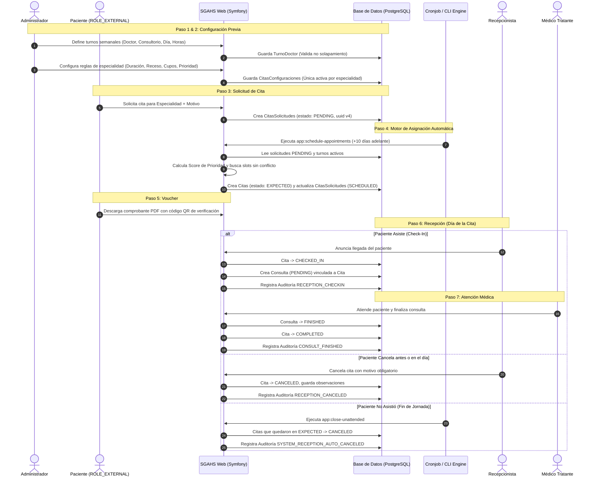
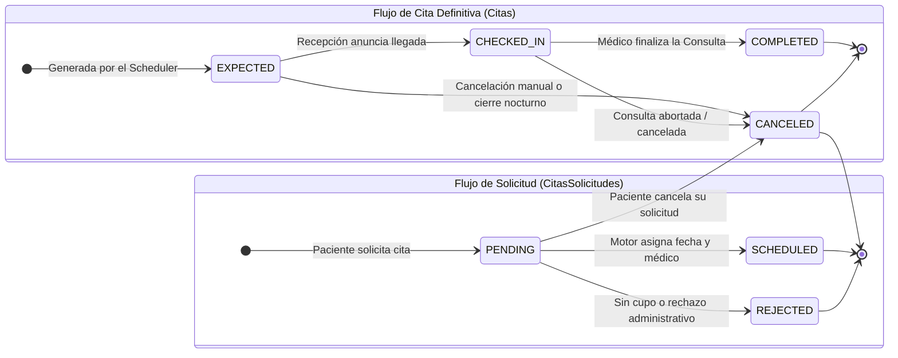

# 📋 Documentación de Arquitectura y Flujo del Proceso de Citas Médicas (`SGAHS`)

> **Propósito del Documento:**  
> Este documento sirve como guía maestra y fuente de verdad técnica para agentes de IA y desarrolladores de software sobre el ciclo de vida, configuración, lógica de negocio, arquitectura de base de datos, algoritmos de asignación, auditoría y controladores del módulo de **Citas Médicas** en el sistema **SGAHS**.

---

## 📑 Tabla de Contenidos

1. [Visión General y Ciclo de Vida](#1-visión-general-y-ciclo-de-vida)
2. [Diagramas de Flujo y Estados (Mermaid)](#2-diagramas-de-flujo-y-estados-mermaid)
3. [Matriz de Archivos y Componentes Clave](#3-matriz-de-archivos-y-componentes-clave)
4. [Fase 1: Configuración de Turnos Médicos (`TurnoDoctor`)](#fase-1-configuración-de-turnos-médicos-turnodoctor)
5. [Fase 2: Configuración de Reglas de Cita (`CitasConfiguraciones`)](#fase-2-configuración-de-reglas-de-cita-citasconfiguraciones)
6. [Fase 3: Solicitud de Citas por Pacientes (`CitasSolicitudes`)](#fase-3-solicitud-de-citas-por-pacientes-citassolicitudes)
7. [Fase 4: Motor de Asignación y Programación Automática (`AppointmentScheduler`)](#fase-4-motor-de-asignación-y-programación-automática-appointmentscheduler)
8. [Fase 5: Emisión de Comprobante / Voucher PDF](#fase-5-emisión-de-comprobante--voucher-pdf)
9. [Fase 6: Recepción, Anuncio de Llegada y Cancelaciones (`CitasController`)](#fase-6-recepción-anuncio-de-llegada-y-cancelaciones-citascontroller)
10. [Fase 7: Cierre Nocturno Automático de Citas Abandonadas (`AppointmentCleaner`)](#fase-7-cierre-nocturno-automático-de-citas-abandonadas-appointmentcleaner)
11. [Fase 8: Traspaso a Consulta Médica y Finalización (`ConsultaController`)](#fase-8-traspaso-a-consulta-médica-y-finalización-consultacontroller)
12. [Fase 9: Auditoría, Reportes PDF y Analítica](#fase-9-auditoría-reportes-pdf-y-analítica)

---

## 1. Visión General y Ciclo de Vida

El proceso de citas en SGAHS funciona bajo una arquitectura desacoplada y orientada a eventos por lotes (batch scheduling), compuesta por 4 etapas fundamentales:

1. **Configuración Institucional (Administración):** Se definen los horarios semanales de los médicos (`TurnoDoctor`) y las reglas de agendamiento por especialidad (`CitasConfiguraciones`).
2. **Cola de Solicitudes (Pacientes Externos):** Los pacientes registrados con perfil validado solicitan una cita en una especialidad (`CitasSolicitudes` en estado `PENDING`).
3. **Motor Heurístico de Asignación (CLI / Cron):** Un comando automatizado evalúa las solicitudes acumuladas, calcula una puntuación de prioridad por edad y tiempo de espera, genera franjas horarias libres basadas en los turnos y programa la cita definitiva (`Citas` en estado `EXPECTED`, solicitud en `SCHEDULED`).
4. **Operación en Recepción y Consulta Médica:** Al llegar el día, recepción anuncia la llegada (`CHECKED_IN`), lo que engendra automáticamente un acto médico (`Consulta` en estado `PENDING`). Cuando el médico finaliza la consulta, la cita se marca como completada (`COMPLETED`). Si el paciente no se presentó, el proceso nocturno la cancela (`CANCELED`).

---

## 2. Diagramas de Flujo y Estados (Mermaid)

### 2.1 Diagrama de Secuencia End-to-End



### 2.2 Diagrama de Máquinas de Estados



---

## 3. Matriz de Archivos y Componentes Clave

| Capa | Archivo / Clase | Responsabilidad Principal |
| :--- | :--- | :--- |
| **Entidad** | `src/Entity/TurnoDoctor.php` | Disponibilidad recurrente semanal de médicos en consultorios. |
| **Entidad** | `src/Entity/CitasConfiguraciones.php` | Parámetros de atención por especialidad (duración, receso, límites, prioridad). |
| **Entidad** | `src/Entity/CitasSolicitudes.php` | Solicitud formal de cita realizada por un paciente externo. |
| **Entidad** | `src/Entity/Citas.php` | Cita médica programada con fecha, hora, médico y consultorio asignados. |
| **Entidad** | `src/Entity/Consulta.php` | Expediente del acto médico clínico generado tras el check-in. |
| **Enum** | `src/Enum/CitasSolicitudesEstados.php` | Estados: `PENDING`, `PROCESSING`, `SCHEDULED`, `REJECTED`, `CANCELED`. |
| **Enum** | `src/Enum/CitasEstados.php` | Estados: `EXPECTED`, `CHECKED_IN`, `COMPLETED`, `CANCELED`. |
| **Enum** | `src/Enum/AuditTipos.php` | Tipos de auditoría de citas (`RECEPTION_CHECKIN`, `RECEPTION_CANCELED`, etc.). |
| **Validador** | `src/Validator/NoShiftOverlap.php` | Impide que un médico o consultorio se solapen en horario. |
| **Validador** | `src/Validator/OneActiveConfigPerSpecialty.php` | Garantiza solo una configuración activa por especialidad. |
| **Servicio** | `src/Service/AppointmentScheduler.php` | Algoritmo heurístico de asignación, puntuación de prioridad y slots. |
| **Servicio** | `src/Service/AppointmentCleaner.php` | Cierre automático al finalizar la jornada de citas no atendidas. |
| **Servicio** | `src/Service/AuditService.php` | Registro inmutable de eventos con usuario, paciente, fecha y contexto. |
| **Comando** | `src/Command/ScheduleAppointmentsCommand.php` | CLI `app:schedule-appointments` para programar citas a +10 días. |
| **Comando** | `src/Command/CloseUnattendedAppointmentsCommand.php` | CLI `app:close-unattended` para cerrar citas abandonadas. |
| **Controlador**| `src/Controller/TurnoDoctorController.php` | CRUD de turnos, `/api/validate-conflict`, vista FullCalendar. |
| **Controlador**| `src/Controller/CitasConfiguracionesController.php`| CRUD de configuraciones, `/api/validate-capacity`, toggle active. |
| **Controlador**| `src/Controller/CitasSolicitudesController.php`| Solicitud paciente, cancelación, generación de Voucher PDF. |
| **Controlador**| `src/Controller/CitasController.php` | Bandeja de recepción, check-in, cancelación, reportes PDF. |
| **Controlador**| `src/Controller/ConsultaController.php` | Consulta médica que al finalizar (`app_consulta_finalizar`) cierra la Cita en `COMPLETED`. |
| **Controlador**| `src/Controller/CitasEstadisticasController.php`| Reportes gráficos, métricas diarias y desglose por especialidad. |

---

## Fase 1: Configuración de Turnos Médicos (`TurnoDoctor`)

Los turnos médicos representan el horario habitual de consulta de los especialistas.

### Campos Principales
- `doctor`: Relación ManyToOne con `InternalProfile` (médico).
- `especialidad`: Relación ManyToOne con `Especialidades`.
- `consultorio`: Relación ManyToOne con `Consultorios`.
- `dayOfWeek`: Entero del 1 (Lunes) al 7 (Domingo).
- `startTime` / `endTime`: Objetos `DateTime` (formato hora).
- `isActive`: Booleano para activar/desactivar el turno.
- `status`: Control de borrado lógico (`StatusRecord`).

### Reglas de Validación
1. **Hora Fin Posterior:** `validateDates()` asegura que `endTime > startTime`.
2. **Validación Anti-Solapamiento (`NoShiftOverlap`):**
   - No se permite que el **mismo médico** tenga dos turnos que se crucen en el mismo día.
   - No se permite que el **mismo consultorio** esté ocupado por dos médicos a la misma hora en el mismo día.
3. **Endpoint Asíncrono de Validación:**  
   `POST /turno/doctor/api/validate-conflict` permite validar en tiempo real desde la interfaz antes de guardar.
4. **Visualización FullCalendar:**  
   `GET /turno/doctor/turnos/json` entrega los eventos mapeando domingo (7 $\to$ 0) y generando colores únicos por especialidad.

---

## Fase 2: Configuración de Reglas de Cita (`CitasConfiguraciones`)

Cada especialidad médica requiere parámetros operativos específicos para que el motor sepa cómo particionar el tiempo de los médicos.

### Parámetros Configurables
- `especialidad`: Especialidad médica asociada.
- `duracionCita`: Duración estimada de cada cita médica en minutos (ej: 20 min).
- `tieneTiempoReceso` / `tiempoReceso`: Margen de descanso o sanitización entre citas en minutos (ej: 5 min).
- `maxPacientesDia`: Cupo máximo de pacientes asignables por día para toda la especialidad (evita sobrecarga médica).
- `tieneEdadPrioridad` / `edadPrioridad`: Umbral de edad (en años) a partir del cual el paciente recibe trato prioritario (ej: 60 años).
- `isActive`: Solo las configuraciones activas son procesadas por el motor.

### Reglas de Validación
1. **Regla de Unicidad Activa (`#[OneActiveConfigPerSpecialty]`):**  
   Solo puede existir **una** configuración activa por especialidad a la vez. Al crearse, por defecto `isActive = false` y se activa manualmente mediante `toggle-active`.
2. **Edad de Prioridad Condicional:**  
   Si `tieneEdadPrioridad` está marcado como `true`, `edadPrioridad` no puede ser nulo (`validateEdadPrioridad`).
3. **Cálculo de Capacidad Máxima Teórica (`/api/validate-capacity`):**  
   Calcula la cantidad máxima de slots diarios posibles sumando todos los turnos activos de los médicos para esa especialidad:
   $$\text{Slot Total} = \text{duracionCita} + \text{tiempoReceso}$$

---

## Fase 3: Solicitud de Citas por Pacientes (`CitasSolicitudes`)

Los usuarios con rol `ROLE_EXTERNAL` solicitan su cita médica a través del portal de pacientes.

### Condiciones Previas
1. **Perfil Validado:** El usuario debe poseer un `ExternalProfile` asociado a un registro de `Paciente` formal.
2. **Comprobación de Estado Vital:** Si `$paciente->isFallecido() === true`, el sistema bloquea inmediatamente la solicitud por políticas de seguridad hospitalaria.

### Estados de la Solicitud (`CitasSolicitudesEstados`)
- `PENDING`: Solicitud creada, a la espera de ser procesada por el motor.
- `SCHEDULED`: Cita programada formalmente con médico, fecha y hora.
- `CANCELED`: Solicitud cancelada por el propio paciente antes de su atención.
- `REJECTED`: Solicitud desestimada administrativamente.

---

## Fase 4: Motor de Asignación y Programación Automática (`AppointmentScheduler`)

El corazón del agendamiento es el comando `app:schedule-appointments`, ejecutado por cron o consola:

```bash
php bin/console app:schedule-appointments
```

### 1. Ventana de Tiempo (Lookahead)
El agendador no programa citas para el mismo día ni para emergencias inmediatas. Su objetivo es el agendamiento programado:
- **Fecha Inicial:** Comienza a buscar cupos **a partir de $+10$ días en el futuro** (`new \DateTime('+10 day')`).
- **Límite de Seguridad:** Evalúa hasta un máximo de 365 días adelante para evitar bucles infinitos.

### 2. Algoritmo de Puntuación de Prioridad (Priority Score)
Antes de asignar fechas, todas las solicitudes en estado `PENDING` para la especialidad son ordenadas de mayor a menor puntuación:

$$\text{Score} = (\text{Es Mayor Prioritario} \times 1000) + \text{Horas Transcurridas en Espera}$$

* **Bono de Edad:** Si el paciente cumple o supera la `edadPrioridad`, recibe $+1000$ puntos (garantiza que adultos mayores o niños según la regla pasen primero).
* **Antigüedad:** Cada hora que la solicitud ha esperado desde su creación (`created`) suma $+1$ punto (mecanismo anti-inanición para solicitudes estándar).

### 3. Generación de Franjas Horarias (*Slots*)
Para cada día analizado:
1. Se consultan los `TurnoDoctor` activos de la especialidad que coincidan con el día de la semana (`dayOfWeek`).
2. Cada turno se fragmenta en intervalos exactos de `duracionCita`.
3. El cursor de tiempo avanza agregando `duracionCita + tiempoReceso`.
4. Si un slot excede la hora de fin del turno, se descarta.

### 4. Detección Exhaustiva de Conflictos
Un slot es asignable a un paciente si cumple:
- No se ha superado el `maxPacientesDia` de la configuración.
- El slot no se solapa con ninguna cita ya existente en la base de datos o agendada en la misma corrida en memoria.
- **Sin conflicto de Médico:** El doctor no tiene otra cita a esa hora.
- **Sin conflicto de Consultorio:** El espacio físico está desocupado.
- **Sin conflicto de Paciente:** El paciente no tiene otra cita en ninguna otra especialidad a esa misma hora.

### 5. Persistencia Atómica
Al emparejar satisfactoriamente solicitud y slot:
- Se crea la entidad `Citas` con estado `CitasEstados::EXPECTED`.
- La `CitasSolicitudes` pasa a estado `CitasSolicitudesEstados::SCHEDULED`.
- Se asocian bidireccionalmente.

---

## Fase 5: Emisión de Comprobante / Voucher PDF

Una vez que la solicitud está en estado `SCHEDULED`, el paciente puede obtener su comprobante:

* **Ruta:** `GET /citas/solicitudes/{uuid}/voucher`
* **Formato:** Documento PDF en tamaño **A5 vertical** generado mediante Dompdf.
* **Seguridad y Validación QR:**  
  El voucher incluye un código QR que apunta a la ruta pública de verificación del hospital:
  ```
  https://dominio/verificaciones/cita/{cita.uuid}
  ```
  Permite al personal de seguridad y recepción certificar la autenticidad del agendamiento escaneando el papel o la pantalla del teléfono del paciente.

---

## Fase 6: Recepción, Anuncio de Llegada y Cancelaciones (`CitasController`)

El personal de recepción gestiona la jornada desde `/citas/listado`, utilizando una DataTable con filtros por fecha y estado (`expected`, `checked_in`, `completed`, `canceled`, `all`).

### 6.1 Anuncio de Llegada / Check-In (`app_citas_checkin`)
Ruta: `POST /citas/{id}/check-in`

1. **Prevención de Doble Check-in:** Verifica que `$cita->getConsulta() === null`.
2. **Transición de Estado:** `$cita->setEstadoCita(CitasEstados::CHECKED_IN)`.
3. **Generación del Acto Médico (`Consulta`):**
   - Instancia automáticamente una nueva entidad `Consulta`.
   - Tipo de consulta: `ConsultaTipos::CT_GENERAL`.
   - Estado de consulta: `ConsultaEstados::PENDING`.
   - Copia automáticamente: `paciente`, `doctor`, `especialidad` y marca `fechaInicio = now()`.
   - Asocia `$cita->setConsulta($consulta)`.
4. **Auditoría:**  
   Registra en el log de auditoría el evento `AuditTipos::RECEPTION_CHECKIN` vinculando paciente y consulta.
5. El paciente aparece instantáneamente en la cola de trabajo del médico tratante en sala de espera.

### 6.2 Cancelación Manual en Recepción (`app_citas_canceled`)
Ruta: `POST /citas/{id}/canceled`

1. **Motivo Obligatorio:** Recepción debe proporcionar un string `motivo_cancelacion` mediante modal.
2. **Transición de Estado:** `$cita->setEstadoCita(CitasEstados::CANCELED)`.
3. **Observaciones:** El motivo se guarda en `$cita->setObservaciones($motivo)`.
4. **Auditoría:** Registra `AuditTipos::RECEPTION_CANCELED`.

---

## Fase 7: Cierre Nocturno Automático de Citas Abandonadas (`AppointmentCleaner`)

Para evitar que citas no atendidas queden indefinidamente como "esperadas" ensuciando los reportes de asistencias, se dispone de un proceso de barrido:

```bash
php bin/console app:close-unattended
# Opcional: para auditar el día anterior
php bin/console app:close-unattended --yesterday
```

### Lógica Operativa (`AppointmentCleaner::closeUnattendedAppointments`)
1. Busca todas las citas de la fecha objetivo con estado `CitasEstados::EXPECTED`.
2. Cambia su estado a `CANCELED`.
3. Inyecta el motivo institucional:
   > *"Cancelación automática: El paciente no se presentó a la cita."*
4. Dispara un registro en `AuditService` con `AuditTipos::SYSTEM_RECEPTION_AUTO_CANCELED`.

---

## Fase 8: Traspaso a Consulta Médica y Finalización (`ConsultaController`)

El médico especialista visualiza a los pacientes que han realizado check-in en su bandeja de consultas pendientes.

1. **Atención Médica:** El doctor evalúa al paciente, registra motivo, evolución, diagnóstico CIE-10, récipe y órdenes médicas.
2. **Cierre de la Atención (`app_consulta_finalizar`):**  
   Ruta: `POST /consulta/{id}/finalizar`
   - La entidad `Consulta` se actualiza a `ConsultaEstados::FINISHED` con `fechaFin = now()`.
   - El sistema busca la cita vinculada a esta consulta:
     ```php
     $cita = $em->getRepository(Citas::class)->findOneBy(['consulta' => $consulta->getId()]);
     if ($cita) {
         $cita->setEstadoCita(CitasEstados::COMPLETED);
     }
     ```
   - Registra auditoría: `AuditTipos::CONSULT_FINISHED`.
   - La cita queda formalmente como **`COMPLETED` (Completada)**.

---

## Fase 9: Auditoría, Reportes PDF y Analítica

### 9.1 Registro de Auditoría (`AuditService`)
Cada movimiento crítico del ciclo de citas queda indexado de manera inmutable en la tabla de auditoría:
* `RECEPTION_CHECKIN`: Paciente anunciado en recepción.
* `RECEPTION_CANCELED`: Cita cancelada con motivo en recepción.
* `SYSTEM_RECEPTION_AUTO_CANCELED`: Barrido nocturno por inasistencia.
* `CONSULT_FINISHED`: Consulta médica concluida y cita completada.

### 9.2 Reportes PDF de Citas (`CitasController::generatePdfReport`)
- Los usuarios pueden exportar el listado filtrado de citas haciendo clic en "Generar Reporte PDF".
- **Límite de Seguridad:** Máximo 1000 registros por descarga para evitar saturación de memoria.
- **UX en Pestaña Aparte:** El formulario web utiliza `formtarget="_blank"` y Stimulus para abrir el reporte en una nueva pestaña sin perder los filtros actuales.
- **Trazabilidad:** El pie del reporte imprime el usuario generador y la hora exacta en zona horaria `America/Caracas`.

### 9.3 Estadísticas de Citas (`CitasEstadisticasController`)
Ubicado en `/citas/estadisticas/listado`:
- **Gráficos Interactivos (Chart.js):** Curvas de evolución por día agrupando citas por estado (`Esperado`, `Atendido`, `Finalizado`, `Cancelado`).
- **Cards de Métricas:** Totales consolidados por estado en el rango de fechas.
- **Desglose por Especialidad:** Distribución de demanda para optimizar la planificación de nuevos turnos médicos.

---

> 📌 **Nota para Agentes:** Al implementar cambios o nuevas funcionalidades que interactúen con Citas, asegúrese de preservar la integridad de los Enums, los eventos de `AuditService`, y respetar el desacoplamiento entre la solicitud (`CitasSolicitudes`), la cita física (`Citas`) y el acto clínico (`Consulta`).
