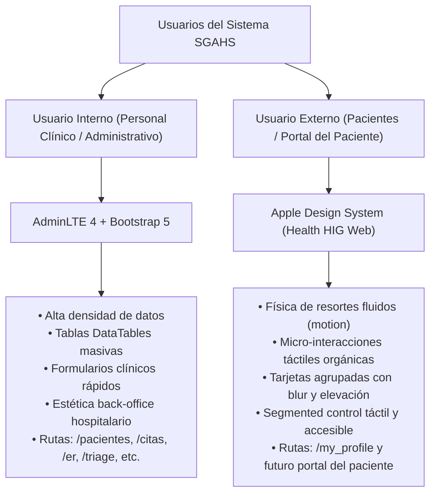

# Stack Visual, Arquitectura de Frontend y Guía de Diseño (SGAHS)

> **PROPÓSITO DE ESTE DOCUMENTO:**  
> Servir como referencia técnica integral y de contexto rápido para **Agentes de Inteligencia Artificial (IA)** y desarrolladores humanos sobre el stack visual, arquitectura de componentes, librerías, herramientas y convenciones de diseño del sistema hospitalario SGAHS (Symfony 7.3).

---

## 1. Arquitectura Visual Dual (Dos Tipos de Usuario)

El proyecto implementa una **arquitectura visual desacoplada** para dos audiencias con necesidades y contextos de uso completamente distintos:



### 1.1. Personal Interno (Back-Office Médico y Administrativo)
- **Roles:** Médicos, enfermeros, personal de triaje, camilleros, farmacia, recepcionistas, administradores.
- **Filosofía:** Eficiencia, rapidez de consulta y alta densidad de información.
- **Base Visual:** [AdminLTE v4](https://adminlte.io/) montado sobre [Bootstrap 5.3](https://getbootstrap.com/).
- **Plantilla Maestra:** `templates/base.html.twig` (con sidebar retráctil, navbar superior con alertas y paneles de control).

### 1.2. Usuario Externo (Portal del Paciente / `/my_profile`)
- **Roles:** Pacientes, tutores y familiares directos.
- **Filosofía:** Claridad, empatía, calma visual, legibilidad biológica y retroalimentación táctil de alta gama.
- **Base Visual:** **Apple Health / iOS Human Interface Guidelines (HIG)** trasladado a web.
- **Plantilla Maestra / Módulo:** `templates/my_profile/show.html.twig` y parciales en `templates/my_profile/tabs/`.

---

## 2. ⚠️ MANDATO OBLIGATORIO PARA AGENTES DE IA (Interfaz Externa)

> [!IMPORTANT]
> **REGLA ESTRICTA DE DISEÑO PARA EL USUARIO EXTERNO:**  
> Cualquier modificación, planificación, propuesta o implementación de código sobre la interfaz visual del usuario externo (incluyendo el perfil del paciente `/my_profile`, futuras vistas de citas del paciente, historial clínico del paciente y portales de autoatención) **DEBE regirse obligatoriamente por las directrices y principios de la skill `apple-design`** localizada en:
> 
> 👉 `.agent/skills/apple-design/SKILL.md`

### Principios Fundamentales Obligatorios de Apple Design:
1. **Física de Resortes (Spring Motion):** Todo elemento interactivo que se mueva o reaccione al toque debe usar curvas físicas elásticas reales (`type: 'spring'`), evitando transiciones lineales rígidas (`linear`) o genéricas (`ease-in-out`).
2. **Materiales y Profundidad:** Jerarquía visual basada en elevación suave, fondos translúcidos, desenfoque óptico de fondo (`backdrop-filter: blur(12px)`), bordes sutiles semi-transparentes (`rgba(0, 0, 0, 0.05 - 0.08)` / en modo oscuro `rgba(255, 255, 255, 0.08 - 0.12)`) y radios de esquina generosos (`16px` a `24px`).
3. **Micro-interacciones y Tactilidad:** Botones, pastillas e insignias deben proveer retroalimentación visual inmediata al presionar (micro-escala elástica ~`0.97`).
4. **Controles Segmentados Fluidos:** Los menús de cambio de vista deben adoptar la forma de *Apple Segmented Controls* (pastillas sobre fondo agrupado), con navegación suave por arrastre y desplazamiento automático hacia la pastilla activa.
5. **Tipografía Óptica y Jerarquía:** Uso de fuentes del sistema (`-apple-system, BlinkMacSystemFont, "SF Pro Text", "Segoe UI", Roboto`), con espaciado entre letras (*tracking*) reducido en títulos grandes (`letter-spacing: -0.025em`) y contraste nítido.
6. **Accesibilidad y `prefers-reduced-motion`:** Ninguna animación debe forzarse si el usuario tiene activada la preferencia de reducción de movimiento en su sistema operativo.

---

## 3. Inventario del Stack Tecnológico Visual

A continuación se detalla el conjunto de librerías y tecnologías frontend instaladas en el proyecto (`package.json`):

### 3.1. Núcleo de Estilos y Estructura
| Tecnología | Versión | Propósito en el Proyecto |
| :--- | :--- | :--- |
| **Bootstrap** | `^5.3.8` | Framework base para rejilla (grid), tipografía, utilidades flexbox y componentes estándar (modales, offcanvas, toasts). |
| **AdminLTE** | `^4.0.0-rc3` | Tema del panel de administración hospitalario para el personal interno. |
| **Sass / Dart Sass** | `^1.94.1` | Preprocesador para modularización de estilos (`patient_portal_apple.scss`, variables personalizadas). |
| **Bootstrap Icons** | `^1.13.1` | Iconografía principal (`bi bi-*`) para estados clínicos, signos vitales y controles. |
| **FontAwesome Free** | `^6.7.1` | Iconografía médica especializada adicional (`fa-solid fa-head-side-cough`, `fa-syringe`, etc.). |

### 3.2. Reactividad, Animación e Interactividad
| Librería | Versión | Propósito y Controladores Stimulus Asociados |
| :--- | :--- | :--- |
| **Hotwired Stimulus** | `^3.0.0` | Arquitectura modular de micro-controladores de comportamiento JS desacoplados (`assets/controllers/*_controller.js`). |
| **Motion (Motion One)** | `^14.10.1` | Motor de física de resortes elásticos de Apple. Usado en `apple_spring_controller.js` para micro-interacciones táctiles. |
| **@formkit/auto-animate** | `^0.10.2` | Animaciones automáticas de adición, remoción y transición de nodos en DOM. Usado en `auto_animate_controller.js` para transiciones de pestañas y acordeones. |
| **Hotwired Turbo** | `^7.1.0` | Soporte Turbo (`Turbo.session.drive = false` configurado globalmente para preservar comportamiento SPA controlado). |

### 3.3. Componentes Especializados de Datos y UI
| Librería | Versión | Rol Clínico / Visual |
| :--- | :--- | :--- |
| **DataTables** | `^2.3.4` | Tablas de datos dinámicas con paginación, búsqueda, ordenamiento y diseño responsivo (`datatables.net-bs5`, `datatables.net-responsive-bs5`). |
| **ApexCharts** | `^5.3.6` | Visualización de métricas avanzadas, tendencias biológicas y dashboards interactivos. |
| **Chart.js** | `^4.5.1` | Gráficos clínicos secundarios y estadísticas de triaje/camas. |
| **FullCalendar** | `^6.1.19` | Sistema de agenda, programación de citas médicas y calendarios de turnos médicos en español. |
| **SweetAlert2** | `^11.26.4` | Diálogos modales de alerta, advertencias y confirmaciones de acciones críticas (ej. borrado lógico). |
| **Select2** | `^4.1.0-rc.0` | Selectores de búsqueda asíncrona (pacientes, medicamentos, CIE-10) con tema Bootstrap 5 (`select2-bootstrap-5-theme`). |
| **ViewerJS** | `^1.11.7` | Visor modal para radiografías, escaneos médicos y documentos adjuntos de pacientes. |
| **SortableJS** | `^1.15.6` | Arrastre y reordenamiento de elementos en listas clínicas. |
| **Inputmask** | `^5.0.9` | Formateo estricto de cédulas, teléfonos, códigos de historia clínica y horas. |
| **OverlayScrollbars**| `^2.12.0` | Barras de desplazamiento sutiles y personalizadas en paneles internos de AdminLTE. |
| **jsVectorMap** | `^1.7.0` | Mapas vectoriales para distribución epidemiológica o ubicación de sedes. |

---

## 4. Controladores Stimulus Modernos (Apple UI)

En `assets/controllers/` residen los controladores dedicados a la experiencia visual Apple del portal externo:

### 4.1. `apple_spring_controller.js`
- **Uso:** `data-controller="apple-spring"`
- **Función:** Detecta eventos `pointerdown` y `pointerup` para comprimir el elemento a escala `0.97` con física elástica de resorte y devolverlo con rebote orgánico (`bounce: 0.15`).
- **Respeto a Accesibilidad:** Desactivado automáticamente si `prefers-reduced-motion` está activo.

### 4.2. `auto_animate_controller.js`
- **Uso:** `data-controller="auto-animate"`
- **Función:** Inicializa `@formkit/auto-animate` en contenedores de contenido dinámico (como `.tab-content` o listas de tarjetas). Permite transiciones suaves entre pestañas sin requerir reglas CSS manuales de entrada/salida.

### 4.3. `apple_segmented_controller.js`
- **Uso:** `data-controller="apple-segmented"`
- **Función:** Maneja el comportamiento interactivo del *Segmented Control*:
  - **Móvil / Pantallas Táctiles:** No interfiere con el scroll táctil nativo (`pointerType !== 'mouse'`), garantizando respuesta instantánea al toque a 60/120fps.
  - **Escritorio con Ratón:** Traduce la rueda vertical del ratón en desplazamiento horizontal (`wheel`) y permite arrastre (*drag-to-scroll*) con cursor `grab`/`grabbing`.
  - **Auto-centrado:** Al activarse una pestaña (`shown.bs.tab`), la barra se desplaza suavemente para centrar la pastilla seleccionada.
  - **Flechas Chevrons Flotantes:** Muestra botones circulares translúcidos en escritorio cuando hay desbordamiento horizontal.

---

## 5. Reglas Técnicas Críticas para Agentes de IA

Cualquier agente que genere o modifique código frontend en este proyecto debe cumplir las siguientes directrices:

### Regla 1: Encapsulación Estricta de Estilos Externos
- Todo el código SCSS del portal externo debe residir en `assets/styles/patient_portal_apple.scss`.
- **Todos los selectores deben estar anidados dentro de `.apple-portal-container`**.
- ❌ **PROHIBIDO:** Sobrescribir selectores globales de Bootstrap (`.btn`, `.card`, `.table`, `.nav-tabs`) fuera de `.apple-portal-container`, ya que esto rompería la interfaz clínica de AdminLTE utilizada por los médicos.

### Regla 2: Integridad de DataTables (`.dtHere`)
- En las tablas HTML que serán inicializadas por DataTables (marcadas comúnmente con la clase `.dtHere`), **NUNCA** debes colocar una fila con `colspan` en el bloque `` de Twig, por ejemplo:
  ```twig
  {# ❌ INCORRECTO - Provoca error DataTables warning tn/4 #}
  
      <tr>...</tr>
  
      <tr><td colspan="5">No hay registros</td></tr>
  
  ```
  ```twig
  {#  CORRECTO - Dejar vacío para que DataTables gestione el emptyTable #}
  
      <tr>...</tr>
  
  ```

### Regla 3: Diferenciación de Punteros (Touch vs Mouse)
- Al programar interacciones avanzadas o emulaciones de arrastre en JavaScript/Stimulus, **siempre** verifica el tipo de puntero:
  ```javascript
  if (e.pointerType !== 'mouse') return; // Preservar scroll táctil nativo en móviles
  ```
- No añadas listeners bloqueantes (`preventDefault()` o `stopPropagation()`) en fases de captura globales que puedan anular los clics legítimos de Bootstrap en dispositivos táctiles.

### Regla 4: Compatibilidad con Modo Oscuro
- El sistema soporta tema claro y oscuro mediante el atributo `[data-bs-theme="dark"]`.
- En componentes de Apple Design, define siempre los valores equivalentes para modo oscuro:
  - Fondo de tarjeta clara: `#ffffff` con borde `rgba(0,0,0,0.07)` y sombra suave.
  - Fondo de tarjeta oscura: `#1c1c1e` con borde `rgba(255,255,255,0.08)` y sombra profunda.
  - Texto secundario en modo oscuro: tonos legibles con contraste adecuado (`#8e8e93`, `#a1a1a6`).

### Regla 5: Flujo de Compilación y Verificación
Tras modificar cualquier archivo en `assets/styles/` o `assets/controllers/`:
1. Compilar los assets con Webpack Encore:
   ```powershell
   npm run dev
   ```
2. Verificar la sintaxis de las plantillas Twig modificadas:
   ```powershell
   php bin/console lint:twig templates/<directorio>
   ```
