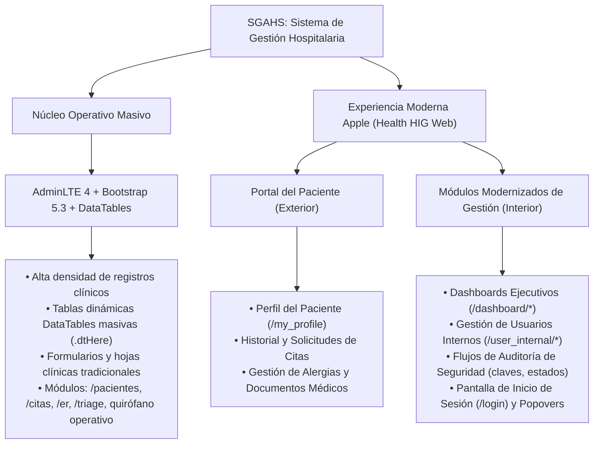

# Stack Visual, Arquitectura de Frontend y Guía de Diseño (SGAHS)

> **PROPÓSITO DE ESTE DOCUMENTO:**  
> Servir como referencia técnica integral y de contexto rápido para **Agentes de Inteligencia Artificial (IA)** y desarrolladores humanos sobre el stack visual, arquitectura de componentes, librerías, herramientas y convenciones de diseño del sistema hospitalario SGAHS (Symfony 7.3).

---

## 1. Arquitectura Visual Híbrida Coexistente

El proyecto implementa una **arquitectura visual híbrida y coexistente** que equilibra la alta densidad operativa del ámbito clínico tradicional con interfaces modernas, humanizadas y táctiles inspiradas en el sistema de diseño de Apple:



### 1.1. Coexistencia Armónica entre AdminLTE y Apple Design
- **AdminLTE v4** proporciona la estructura de cascarón institucional (`templates/base.html.twig`), barra lateral retráctil y barra de navegación superior.
- **Apple Design System (Health HIG Web)** se integra **dentro** de AdminLTE o en vistas dedicadas a través del namespace `.apple-portal-container` y tarjetas `.apple-form-card`, `.apple-table-card` y `.apple-auth-card`.
- Esta separación modular garantiza que las vistas modernizadas disfruten de micro-interacciones táctiles, resortes elásticos y estética de vidrio esmerilado (*frosted glass*) **sin romper ni desestabilizar** los componentes tradicionales de alta densidad de datos utilizados por el personal asistencial.

---

## 2. ⚠️ MANDATO OBLIGATORIO PARA AGENTES DE IA (Interfaces Apple Design)

> [!IMPORTANT]
> **REGLA ESTRICTA DE DISEÑO:**  
> Cualquier modificación, planificación, propuesta o implementación de código sobre vistas modernizadas —incluyendo el perfil del paciente `/my_profile`, dashboards ejecutivos `/dashboard/*`, gestión de usuarios `/user_internal/*`, vistas de auditoría de seguridad y autenticación `/login`— **DEBE regirse obligatoriamente por las directrices y principios de la skill `apple-design`** localizada en:
> 
> 👉 `.agent/skills/apple-design/SKILL.md`

### Principios Fundamentales Obligatorios de Apple Design:
1. **Física de Resortes (Spring Motion):** Todo elemento interactivo que se mueva o reaccione al toque debe usar curvas físicas elásticas reales (`type: 'spring'`), evitando transiciones lineales rígidas (`linear`) o genéricas (`ease-in-out`).
2. **Materiales y Profundidad:** Jerarquía visual basada en elevación suave, fondos translúcidos, desenfoque óptico de fondo (`backdrop-filter: blur(20px - 25px)`), bordes sutiles semi-transparentes (`rgba(0, 0, 0, 0.05 - 0.08)` / en modo oscuro `rgba(255, 255, 255, 0.08 - 0.12)`) y radios de esquina generosos (`16px` a `26px`).
3. **Micro-interacciones y Tactilidad:** Botones, pastillas e insignias deben proveer retroalimentación visual inmediata al presionar (micro-escala elástica ~`0.97`).
4. **Controles Segmentados Fluidos:** Los menús de cambio de vista deben adoptar la forma de *Apple Segmented Controls* (pastillas sobre fondo agrupado), con navegación suave por arrastre y auto-desplazamiento hacia la pastilla activa.
5. **Tipografía Óptica y Jerarquía:** Uso de fuentes del sistema (`-apple-system, BlinkMacSystemFont, "SF Pro Text", "Segoe UI", Roboto`), con espaciado entre letras (*tracking*) reducido en títulos grandes (`letter-spacing: -0.025em`) y contraste nítido.
6. **Accesibilidad y `prefers-reduced-motion`:** Ninguna animación debe forzarse si el usuario tiene activada la preferencia de reducción de movimiento en su sistema operativo.

---

## 3. Inventario del Stack Tecnológico Visual

Detalle del conjunto de librerías y tecnologías frontend instaladas en el proyecto (`package.json`):

### 3.1. Núcleo de Estilos y Estructura
| Tecnología | Versión | Propósito en el Proyecto |
| :--- | :--- | :--- |
| **Bootstrap** | `^5.3.8` | Framework base para rejilla (grid), tipografía, utilidades flexbox y componentes estándar (modales, offcanvas, toasts). |
| **AdminLTE** | `^4.0.0-rc3` | Tema del cascarón hospitalario para el personal interno. |
| **Sass / Dart Sass** | `^1.94.1` | Preprocesador para modularización de estilos (`patient_portal_apple.scss`, variables personalizadas). |
| **Bootstrap Icons** | `^1.13.1` | Iconografía principal (`bi bi-*`) para estados clínicos, signos vitales y controles. |
| **FontAwesome Free** | `^6.7.1` | Iconografía médica especializada adicional (`fa-solid fa-head-side-cough`, `fa-syringe`, etc.). |

### 3.2. Reactividad, Animación e Interactividad
| Librería | Versión | Propósito y Controladores Stimulus Asociados |
| :--- | :--- | :--- |
| **Hotwired Stimulus** | `^3.0.0` | Arquitectura modular de micro-controladores de comportamiento JS desacoplados (`assets/controllers/*_controller.js`). |
| **Motion (Motion One)** | `^14.10.1` | Motor de física de resortes elásticos de Apple. Usado en `apple_spring_controller.js` para micro-interacciones táctiles. |
| **@formkit/auto-animate** | `^0.10.2` | Animaciones automáticas de adición, remoción y transición de nodos en DOM. Usado en `auto_animate_controller.js` para transiciones de pestañas y acordeones. |
| **Hotwired Turbo** | `^7.1.0` | Soporte Turbo (`Turbo.session.drive = false` configurado globalmente para preservar comportamiento SPA controlado). |

### 3.3. Componentes Especializados de Datos y UI
| Librería | Versión | Rol Clínico / Visual |
| :--- | :--- | :--- |
| **DataTables** | `^2.3.4` | Tablas de datos dinámicas con paginación, búsqueda, ordenamiento y diseño responsivo (`datatables.net-bs5`, `datatables.net-responsive-bs5`). |
| **ApexCharts** | `^5.3.6` | Visualización de métricas avanzadas, tendencias biológicas y dashboards interactivos adaptables a Dark Mode (`dashboard_charts_controller.js`). |
| **Chart.js** | `^4.5.1` | Gráficos clínicos secundarios y estadísticas de triaje/camas. |
| **FullCalendar** | `^6.1.19` | Sistema de agenda, programación de citas médicas y calendarios de turnos médicos en español. |
| **SweetAlert2** | `^11.26.4` | Diálogos modales de alerta, advertencias y confirmaciones de acciones críticas (ej. borrado lógico, auditoría). |
| **Select2** | `^4.1.0-rc.0` | Selectores de búsqueda asíncrona (pacientes, medicamentos, CIE-10) con tema Bootstrap 5 y chips Apple Glass. |
| **ViewerJS** | `^1.11.7` | Visor modal interactivo estilo Apple Quick Look para radiografías, escaneos y fotografías médicas (`apple_image_viewer_controller.js`). |
| **SortableJS** | `^1.15.6` | Arrastre y reordenamiento de elementos en listas clínicas. |
| **Inputmask** | `^5.0.9` | Formateo estricto de cédulas, teléfonos, códigos de historia clínica y horas. |
| **OverlayScrollbars**| `^2.12.0` | Barras de desplazamiento sutiles y personalizadas en paneles internos de AdminLTE. |

---

## 4. Catálogo de Controladores Stimulus Apple UI

En `assets/controllers/` residen los controladores dedicados a la experiencia visual Apple tanto para el portal externo como para módulos modernizados internos:

### 4.1. `apple_spring_controller.js`
- **Uso:** `data-controller="apple-spring"`
- **Función:** Detecta eventos `pointerdown` y `pointerup` para comprimir el elemento a escala `0.97` con física elástica de resorte y devolverlo con rebote orgánico (`bounce: 0.15`).
- **Respeto a Accesibilidad:** Desactivado automáticamente si `prefers-reduced-motion` está activo.

### 4.2. `auto_animate_controller.js`
- **Uso:** `data-controller="auto-animate"`
- **Función:** Inicializa `@formkit/auto-animate` en contenedores de contenido dinámico (como `.tab-content` o listas de tarjetas). Permite transiciones suaves entre pestañas sin requerir reglas CSS manuales de entrada/salida.

### 4.3. `apple_segmented_controller.js`
- **Uso:** `data-controller="apple-segmented"`
- **Función:** Maneja el comportamiento interactivo del *Segmented Control*:
  - **Móvil / Pantallas Táctiles:** No interfiere con el scroll táctil nativo (`pointerType !== 'mouse'`), garantizando respuesta instantánea al toque a 60/120fps.
  - **Escritorio con Ratón:** Traduce la rueda vertical del ratón en desplazamiento horizontal (`wheel`) y permite arrastre (*drag-to-scroll*) con cursor `grab`/`grabbing`.
  - **Auto-centrado:** Al activarse una pestaña (`shown.bs.tab`), la barra se desplaza suavemente para centrar la pastilla seleccionada.
  - **Flechas Chevrons Flotantes:** Muestra botones circulares translúcidos en escritorio cuando hay desbordamiento horizontal.

### 4.4. `password_toggle_controller.js`
- **Uso:** `data-controller="password-toggle"`
- **Estructura Requerida:**
  - Campo de contraseña: `<input type="password" data-password-toggle-target="input">`
  - Botón disparador: `<button type="button" data-action="click->password-toggle#toggle">`
  - Ícono dinámico: `<i class="bi bi-eye-fill" data-password-toggle-target="icon"></i>`
- **Función:** Alterna el tipo de entrada entre `password` y `text`, intercambiando instantáneamente el glifo entre `bi-eye-fill` y `bi-eye-slash-fill` sin alterar el layout ni desfasar el cursor.

### 4.5. `avatar_upload_controller.js`
- **Uso:** `data-controller="avatar-upload"`
- **Función:** Gestiona el uploader circular de perfil estilo Apple ID (104px de diámetro):
  - Previsualización instantánea de la imagen seleccionada vía `FileReader`.
  - Soporte de imagen previa en modo edición.
  - Validación defensiva de límite de tamaño (máx. 2 MB) y formatos permitidos (`image/*`).
  - Botón táctil flotante con micro-resorte `apple-spring`.

### 4.6. `apple_upload_dropzone_controller.js`
- **Uso:** `data-controller="apple-upload-dropzone"`
- **Función:** Zona de carga interactiva estilo iOS para arrastrar y soltar:
  - Retroalimentación visual al arrastrar (`is-dragover`).
  - Previsualización de archivo seleccionado con glifo semántico (rojo para PDF, azul para imágenes) y tamaño formateado (MB/KB).
  - Sugerencia y autocompletado inteligente del nombre del documento si el campo de texto está vacío.

### 4.7. `apple_image_viewer_controller.js`
- **Uso:** `data-controller="apple-image-viewer"`
- **Función:** Envoltura moderna sobre `ViewerJS` al estilo Apple Quick Look:
  - Fondo translúcido con desenfoque de 25px (`backdrop-filter: blur(25px)`).
  - Barra de herramientas en píldora flotante con botón circular de cierre centrado y botón de descarga directa vectorizado.
  - Soporte para zoom táctil, rotación 90°, escala 1:1 y pantalla completa.

### 4.8. `dashboard_charts_controller.js`
- **Uso:** `data-controller="dashboard-charts"`
- **Función:** Gestión reactiva de gráficos estadísticos en dashboards ejecutivos:
  - Escucha síncrona del evento de cambio de tema (`theme:changed`).
  - Conmuta en caliente la paleta de colores (cuadrículas, textos secundarios y bordes de dona) entre Modo Claro y Modo Oscuro ejecutando `chart.update()` sin refrescar la página.

### 4.9. `apple_citas_filter_controller.js`
- **Uso:** `data-controller="apple-citas-filter"`
- **Función:** Filtrado rápido de citas médicas mediante pastillas segmentadas interactivas.

---

## 5. Reglas Técnicas Críticas y Patrones de Arquitectura Frontend

Cualquier agente de IA o desarrollador que genere o modifique código frontend en este proyecto debe cumplir estrictamente las siguientes directrices:

### Regla 1: Encapsulación Estricta y Namespace Apple
- Todo el código SCSS del sistema de diseño Apple reside en `assets/styles/patient_portal_apple.scss`.
- **Los componentes y adaptaciones Apple deben estar contenidos dentro de sus clases selectoras de ámbito:**
  - `.apple-portal-container` (Contenedor maestro para vistas modernizadas).
  - `.apple-form-card` (Tarjetas de formulario compactas).
  - `.apple-auth-card` (Tarjeta de autenticación).
  - `.apple-table-card` (Tarjetas de tablas modernizadas).
- ❌ **PROHIBIDO:** Sobrescribir selectores globales de Bootstrap (`.btn`, `.card`, `.table`, `.nav-tabs`) sin encapsulación, ya que esto rompería la interfaz clínica tradicional de AdminLTE utilizada en el back-office asistencial.

### Regla 2: Integridad de DataTables (`.dtHere`)
- En las tablas HTML que serán inicializadas por DataTables (marcadas comúnmente con la clase `.dtHere`), **NUNCA** debes colocar una fila con `colspan` en el bloque `` de Twig:
  ```twig
  {# ❌ INCORRECTO - Provoca error DataTables warning tn/4 #}
  
      <tr>...</tr>
  
      <tr><td colspan="5">No hay registros</td></tr>
  
  ```
  ```twig
  {#  CORRECTO - Dejar vacío para que DataTables gestione el emptyTable #}
  
      <tr>...</tr>
  
  ```

### Regla 3: Diferenciación de Punteros (Touch vs Mouse)
- Al programar interacciones avanzadas o emulaciones de arrastre en JavaScript/Stimulus, **siempre** verifica el tipo de puntero:
  ```javascript
  if (e.pointerType !== 'mouse') return; // Preservar scroll táctil nativo en móviles
  ```
- No añadas listeners bloqueantes (`preventDefault()` o `stopPropagation()`) en fases de captura globales que puedan anular los clics legítimos de Bootstrap en dispositivos táctiles.

### Regla 4: Compatibilidad con Modo Oscuro
- El sistema soporta tema claro y oscuro mediante el atributo `[data-bs-theme="dark"]`.
- En componentes de Apple Design, define siempre los valores equivalentes para modo oscuro:
  - Fondo de tarjeta clara: `#ffffff` con borde `rgba(0,0,0,0.07)` y sombra suave.
  - Fondo de tarjeta oscura: `#1c1c1e` con borde `rgba(255,255,255,0.08)` y sombra profunda.
  - Fondo de inputs en oscuro: `#242426` con texto `#f5f5f7` y placeholder `#8e8e93`.
  - Texto secundario en modo oscuro: tonos legibles con contraste adecuado (`#8e8e93`, `#a1a1a6`).

### Regla 5: Contención Global contra Desbordamiento de AdminLTE (`.app-main`)
- **Descubrimiento Técnico:** AdminLTE v4 define en `.sidebar-expand-lg.layout-fixed .app-main { flex: 1 1 auto; overflow: auto; }`. Esta regla genera barras de desplazamiento horizontal indeseadas a lo largo de toda la ventana cuando un elemento hijo tiene márgenes negativos (`.row`) o anchos no contenidos.
- **Solución Estándar:** Mantener activa la regla global en `patient_portal_apple.scss`:
  ```scss
  .app-main {
      overflow-x: hidden !important;
  }
  ```
- Asimismo, todas las tarjetas de contenido y contenedores Apple deben portar `overflow-x: clip;` o `box-sizing: border-box;` para blindar la pantalla contra desbordes laterales.

### Regla 6: Arquitectura y Proporción de Formularios Compactos (`.apple-form-card`)
- **Prohibición de Ancho Plano:** En pantallas anchas de escritorio, los formularios **nunca** deben ocupar el 100% del contenedor, ya que genera desiertos visuales y obliga al usuario a desplazarse para ver los botones de acción.
- **Estructura Estándar:**
  ```html
  <div class="apple-portal-container">
      <div class="row justify-content-center">
          <div class="col-12 col-lg-8 col-xl-7">
              <div class="apple-form-card">
                  ...
              </div>
          </div>
      </div>
  </div>
  ```
- **Dimensionamiento SCSS Canónico:**
  ```scss
  .apple-form-card {
      max-width: 820px;
      margin-inline: auto;
      width: 100%;
      box-sizing: border-box;
      overflow-x: clip;
      border-radius: 24px;
      padding: 32px 36px;
      
      @media (max-width: 575.98px) {
          padding: 20px 16px;
          border-radius: 20px;
      }
  }
  ```

### Regla 7: Pestañas de Asistente Adaptativas en Móviles (`.apple-segmented-steps`)
- En asistentes multicapa (asistentes de pasos como `#formTab`), las pestañas deben organizarse semánticamente con número y título:
  ```html
  <button class="nav-link ...">
      <i class="bi bi-shield-lock-fill"></i>
      <span class="apple-tab-num">1.</span>
      <span class="apple-tab-title">Credenciales</span>
  </button>
  ```
- **Comportamiento Responsivo:**
  - En escritorio: Píldoras completas con ícono, número y título.
  - En pantallas compactas (`< 576px`): Las pestañas inactivas se comprimen a `[ Ícono + Número ]` ocupando únicamente ~46px cada una; la pestaña activa (`.active`) se expande dinámicamente (`flex: 1 1 auto`) mostrando su título completo con truncado defensivo (`text-overflow: ellipsis`), eliminando el solapamiento de texto.

### Regla 8: Jerarquía Táctil de Botoneras de Asistente (`.apple-wizard-buttons-grid`)
- Las barras de acciones de asistentes (ej. `#btnToolbar`) deben estructurarse con la clase `.apple-wizard-buttons-grid`:
  - **En Escritorio:** Flujo flexible horizontal con botón *Anterior* a la izquierda, y botones *Cancelar* y *Siguiente / Guardar* a la derecha.
  - **En Móviles (`< 576px`):** Conmuta a una cuadrícula CSS de dos filas:
    - **Fila 1 (100% de ancho):** Botón primario de avance (*Siguiente* o *Guardar*) con altura táctil ergonómica ($\ge$ 44px).
    - **Fila 2 (50% / 50% simétrico):** Botones secundarios (*Anterior* y *Cancelar*) distribuidos uniformemente para evitar que sobresalgan del margen de la tarjeta.

### Regla 9: Estandarización de Entradas de Contraseña y Etiquetas
- **Etiquetas de Campo (`.apple-input-label`):** Deben ser limpias y legibles. **No** deben incluir íconos decorativos duplicados ni emojis.
- **Contenedor `.apple-input-wrap`:**
  - Padding por defecto del input: `12px 44px 12px 16px !important;` garantizando espacio para el botón de acción a la derecha (`right: 10px;`).
  - Si el campo requiere un ícono identificador a la izquierda (`.apple-input-icon`), se utiliza el selector de soporte `:has(.apple-input-icon)` que aplica automáticamente `padding-left: 42px !important;`.
- **Integración con Stimulus:** Conectar siempre `data-controller="password-toggle"` y asignar `data-password-toggle-target="icon"` al elemento `<i>` del glifo.

### Regla 10: Banners de Alertas Modernas Apple Glass (`.apple-alert`)
- Sustituir las alertas planas de Bootstrap tradicional (`.alert.alert-danger`) por el componente Apple Glass:
  ```html
  <div class="apple-alert apple-alert-danger alert-dismissible fade show mb-4" role="alert">
      <div class="apple-alert-icon">
          <i class="bi bi-exclamation-octagon-fill"></i>
      </div>
      <div class="apple-alert-content">
          <h6 class="apple-alert-heading">Por favor corrige los siguientes errores:</h6>
          <ul class="apple-alert-list mb-0">
              ...
          </ul>
      </div>
      <button type="button" class="btn-close apple-alert-close" data-bs-dismiss="alert" aria-label="Close"></button>
  </div>
  ```

### Regla 11: Flujo de Compilación y Verificación
Tras modificar cualquier archivo en `assets/styles/`, `assets/controllers/` o plantillas Twig:
1. Compilar los assets con Webpack Encore:
   ```powershell
   npm run dev
   ```
2. Limpiar la caché de Symfony si se modificaron configuraciones, controladores o rutas:
   ```powershell
   php bin/console cache:clear
   ```
3. Verificar la sintaxis de las plantillas Twig modificadas:
   ```powershell
   php bin/console lint:twig templates/<directorio>
   ```

### Regla 12: Contención de `<fieldset>/<legend>` y Paridad de Selectores (`Select2`)
- **Prohibido desflotar `<legend>` dentro de tarjetas con borde/fondo (`<fieldset class="apple-detail-surface">`):** Bootstrap 5 aplica `legend { float: left; }` precisamente para evitar que el borde y el fondo del `<fieldset>` inicien a mitad vertical del `<legend>`. Nunca usar `float: none` sobre un `<legend>` hijo directo de `<fieldset>` estilizado; mantener `float: left`, `clear: both` en el contenedor de campos siguiente y `min-width: 0; width: 100%;` en el `<fieldset>`. Usar `flex-wrap` en cabeceras `.apple-table-header` con badges para evitar compresión en `320px`.
- **Paridad de `<select>` en vistas Apple:** Todo selector `<select>` agregado en vistas modernizadas (incluidos filtros dinámicos Stimulus fuera de Symfony Forms) debe integrar el componente de la casa **Select2** (`theme: 'bootstrap-5'`) gestionado en su controlador Stimulus tras poblar opciones (`trigger('change.select2')` y `select2('destroy')` en `disconnect()`), manteniendo `color-scheme` y colores de `<option>` como respaldo base en `.apple-portal-container .form-select`.
